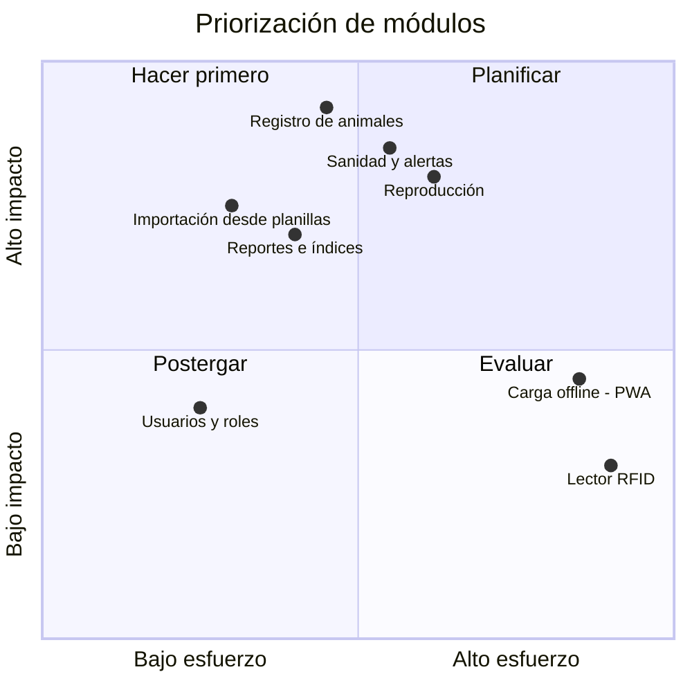

# 01 — Propuesta del Proyecto

> Equivalente a la Actividad 2 de la guía de la cátedra. Fuente principal: *PS_Propuesta_GestionRodeo.pdf*.

## Índice

1. [Datos generales](#1-datos-generales)
2. [Datos del establecimiento](#2-datos-del-establecimiento)
3. [Visión y misión](#3-visión-y-misión)
4. [Situación actual](#4-situación-actual)
5. [Problemática](#5-problemática)
6. [Objetivo general](#6-objetivo-general)
7. [Objetivos específicos (SMART)](#7-objetivos-específicos-smart)
8. [Stakeholders](#8-stakeholders)
9. [Matriz de priorización esfuerzo / impacto](#9-matriz-de-priorización-esfuerzo--impacto)

---

## 1. Datos generales

| | |
|---|---|
| **Proyecto** | Mi Hacienda Digital — Aplicación de Gestión de Rodeo Bovino |
| **Marco** | Práctica Supervisada — Ingeniería en Sistemas de Información |
| **Institución** | Universidad Tecnológica Nacional — Facultad Regional La Plata |
| **Alumno** | Francisco Garcia Martinez |
| **Docente tutor** | Osvaldo Falabella |
| **Carga horaria estimada** | 230 horas |

## 2. Datos del establecimiento

| | |
|---|---|
| **Establecimiento** | Los Álamos |
| **Ubicación** | Provincia de Buenos Aires |
| **Actividad** | Producción ganadera bovina |
| **Sistema productivo** | **Cría** en los últimos años. El sistema contempla también recría e invernada (ciclo completo), a pedido del productor. |
| **Rodeo** | Entre **90 y 103 vacas**, 4 toros, unas 5 vaquillonas y 80 a 90 terneros por año: entre **unas 110 y 200 cabezas** según la época (según los conteos de su cuaderno). Baja de febrero a mayo (venta de terneros, vacas vacías y vacas viejas) y sube desde fines de mayo con las pariciones (fines de mayo a octubre). |
| **Raza** | Aberdeen Angus |
| **Identificación** | Caravana oficial de SENASA, ahora **electrónica** en las compras y las ventas. Los terneros se caravanean al destete. |
| **Personal** | El dueño, que es productor y veterinario. No hay personal fijo: trabaja solo o con un peón. |
| **Contacto** | Juan Pérez — Productor ganadero y veterinario |

> Los datos de contacto (teléfono y correo) figuran en la propuesta formal presentada a la facultad. No se incluyen en este repositorio para no exponer datos personales si el código se publica.

> ✅ **Validado en la entrevista** (ver [guía de entrevista](relevamiento/guia-entrevista-productor.md#respuestas-obtenidas), bloque A): sistema productivo, cantidad de cabezas y su variación en el año, raza, identificación y personal.

## 3. Visión y misión

**Visión del producto:** que el productor de Los Álamos tenga toda la información de su rodeo en un solo lugar, siempre disponible, y tome decisiones con datos y no de memoria.

**Misión del producto:** reemplazar el registro en papel y planillas sueltas por una herramienta simple, pensada para alguien de campo, que registre cada animal y cada evento sanitario y reproductivo, avise lo que está por vencer y muestre los índices del rodeo sin hacer cuentas a mano.

## 4. Situación actual

La administración del rodeo se hace **en papel**. El flujo de trabajo, confirmado en la entrevista con el productor:

1. Durante el trabajo en la manga (vacunación, tacto, yerra), se anota a mano en papel. Anota el productor o, cuando trabaja con un peón, el peón.
2. Al llegar a su casa, el productor pasa esos datos y le lleva un rato hacerlo.
3. Para saber el stock, los índices o qué vacunas faltan, hay que buscar y sumar a mano.
4. No usa ningún otro sistema ni programa ganadero (tampoco SIGSA ni Excel con fórmulas).

Características del usuario principal (informadas por el alumno y confirmadas en la entrevista):

- Usa la **computadora** cuando llega a su casa y ahí hace la carga de datos.
- **No está acostumbrado al celular** y el suyo es un modelo viejo.
- Usa una PC con **Windows** y el navegador **Chrome**.
- Tiene **buena conexión** a internet en su casa.
- Tiene **impresora** y le podría interesar imprimir listados o reportes.

> ✅ **Validado en la entrevista.** Se vieron fotos del cuaderno de campo (2026-11-03): anota a diario, con fecha, partos, castraciones, tratamientos, muertes, conteos de stock, ventas, compras y la alimentación del rodeo.

## 5. Problemática

| # | Problema | Consecuencia |
|---|---|---|
| P1 | La información del rodeo está en papel y planillas dispersas. | Se pierden datos, hay duplicados y cuesta encontrar el historial de un animal. |
| P2 | No hay alertas de vencimientos sanitarios. | Riesgo de olvidar vacunas obligatorias o refuerzos, con multas o problemas sanitarios. |
| P3 | El seguimiento reproductivo (servicios, tactos, pariciones) depende de la memoria y de anotaciones sueltas. | Vacas vacías que siguen en el rodeo sin detectarse y menor eficiencia reproductiva. |
| P4 | Calcular stock e índices lleva tiempo y es propenso a errores. | Las decisiones de venta, descarte y reposición se toman sin datos confiables. |
| P5 | La información depende de una sola persona y de un solo soporte físico. | Si se pierde la libreta o la planilla, se pierde la historia del rodeo. |
| P6 | No se lleva la cuenta de cuántos terneros se enferman (diarrea, neumonía) o mueren, ni de las causas. | No se puede medir el problema sanitario que más le preocupa al productor ni saber si las medidas funcionan. |

> ✅ **Validado en la entrevista.** El productor confirmó que P2 y P3 son riesgos reales en su trabajo. Además, lo que más le cuesta encontrar hoy son las fechas del plan sanitario.

## 6. Objetivo general

Desarrollar una aplicación web para la gestión integral del rodeo bovino del establecimiento Los Álamos, que permita al productor llevar un registro centralizado y actualizado de sus animales y optimizar el control sanitario, reproductivo y productivo del ganado, con alertas automáticas y reportes basados en datos históricos.

## 7. Objetivos específicos (SMART)

| Código | Objetivo | Específico | Medible | Alcanzable | Relevante | Temporal |
|---|---|---|---|---|---|---|
| **OE-01** | Centralizar el registro individual de todos los animales del establecimiento. | Ficha por animal con caravana, categoría, raza e historial. | 100% del rodeo activo cargado en el sistema. | Importación inicial desde planillas (RF-014). | Resuelve P1 y P5. | Al finalizar el módulo de animales (etapa 3). |
| **OE-02** | Controlar la sanidad del rodeo con alertas de vencimientos. | Registro de vacunas y tratamientos con alertas. | 0 vacunas obligatorias vencidas sin alerta previa durante la prueba. | Alertas calculadas a partir del plan sanitario. | Resuelve P2 y P6. | Al finalizar la etapa 4. |
| **OE-03** | Llevar el control reproductivo completo del rodeo de cría. | Celos, servicios, tactos, pariciones y destetes. | 100% de los eventos de la temporada registrados y vinculados a cada vaca. | Carga por jornada en la manga. | Resuelve P3. | Al finalizar la etapa 5. |
| **OE-04** | Obtener stock e índices productivos sin cálculos manuales. | Reportes de stock, preñez, parición, destete y mortandad. | Reporte generado en menos de 1 minuto, con valores iguales al cálculo manual de control. | Calculados con los datos ya cargados. | Resuelve P4. | Al finalizar la etapa 6. |
| **OE-05** | Garantizar acceso seguro según el rol de cada usuario. | Usuarios con roles y permisos. | 100% de las funcionalidades restringidas según la matriz de roles. | Control de acceso por rol estándar. | Protege los datos del establecimiento. | Transversal, verificado en la etapa 7. |
| **OE-06** | Lograr que el productor use el sistema de forma autónoma. | Interfaz simple y capacitación. | El productor completa las cargas frecuentes sin ayuda después de una capacitación de 1 hora. | Diseño para PC, letra grande, lenguaje de campo. | Sin adopción no hay beneficio. | Al cierre del proyecto (etapa 7). |

## 8. Stakeholders

| Stakeholder | Rol en el proyecto | Interés | Influencia | Estrategia |
|---|---|---|---|---|
| **Juan Pérez** (productor y veterinario) | Cliente, único usuario al inicio (Administrador), Product Owner y veterinario del establecimiento | Alto | Alta | Gestionar de cerca: validar cada entregable con él, incluidos sanidad y reproducción. |
| **Francisco Garcia Martinez** | Alumno: analista, desarrollador, tester y PM | Alto | Alta | — |
| **Osvaldo Falabella** (docente tutor) | Supervisión académica | Alto | Alta | Informes de avance periódicos. |
| **UTN FRLP** — Departamento de Sistemas | Aprobación de la Práctica Supervisada | Medio | Alta | Cumplir con las entregas formales. |
| **Peón** (ocasional) | Fuente de datos: a veces anota en la manga | Bajo | Baja | Prever el rol Peón por si el productor quiere darle acceso. |
| **Familia del productor** | Posibles usuarios de solo lectura | Bajo | Baja | Rol Consulta. |
| **SENASA** | Organismo regulador (indirecto) | Bajo | Media | Respetar la normativa de identificación y vacunación. |

> ✅ **Validado en la entrevista.** No hay un veterinario aparte: el productor es veterinario. No hay personal fijo; a veces trabaja con un peón. El sistema lo usará solo el productor, y la familia podría consultarlo.

## 9. Matriz de priorización esfuerzo / impacto

| Cuadrante | Funcionalidades | Decisión |
|---|---|---|
| Alto impacto, bajo esfuerzo | Registro de animales, importación, reportes | Versión 1.0, primeras iteraciones |
| Alto impacto, alto esfuerzo | Sanidad con alertas, reproducción | Versión 1.0 |
| Bajo impacto, bajo esfuerzo | Usuarios y roles | Versión 1.0 (requerido por la propuesta) |
| Bajo impacto, alto esfuerzo | PWA offline, lector RFID | Versión 2.0 |

> ✅ **Validado en la entrevista.** Para el productor los cuatro módulos (animales, sanidad, reproducción y reportes) son igual de importantes. La v1.0 es solo web; una versión móvil podría venir más adelante.

## Historial de versiones

| Versión | Fecha | Autor | Cambios |
|---|---|---|---|
| 0.1 | 2026-10-10 | Francisco Garcia Martinez | Versión inicial a partir de la propuesta de PS |
| 0.2 | 2026-10-10 | Francisco Garcia Martinez | Datos del establecimiento, situación actual y stakeholders validados en la entrevista con el productor (bloques A y B) |
| 0.3 | 2026-10-10 | Francisco Garcia Martinez | Equipo, conexión e impresora del productor (entrevista, bloque F) |
| 0.4 | 2026-10-10 | Francisco Garcia Martinez | Variación del rodeo, identificación con caravana SENASA y dificultad con el plan sanitario (entrevista, bloques A a C) |
| 0.5 | 2026-10-10 | Francisco Garcia Martinez | Nuevo problema P6 (enfermedades y mortalidad de terneros); prioridades y versión web validadas |
| 0.6 | 2026-10-10 | Francisco Garcia Martinez | Sistema productivo corregido (cría, con soporte de ciclo completo); caravana electrónica; superficie no relevante |
| 0.7 | 2026-11-03 | Francisco Garcia Martinez | Tamaño real del rodeo y fechas de parición según el cuaderno del productor |
| 0.8 | 2026-11-03 | Francisco Garcia Martinez | Nombre del proyecto: Mi Hacienda Digital (antes Mi Yerra Digital) |
| 0.9 | 2026-11-03 | Francisco Garcia Martinez | Registros actuales validados con el cuaderno de campo |
| 0.10 | 2026-11-03 | Francisco Garcia Martinez | Datos del productor reemplazados por datos ficticios (nombre, establecimiento, ubicación, códigos SENASA y montos) para publicar el repositorio |
