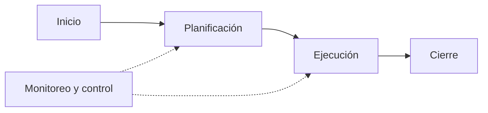
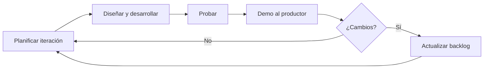
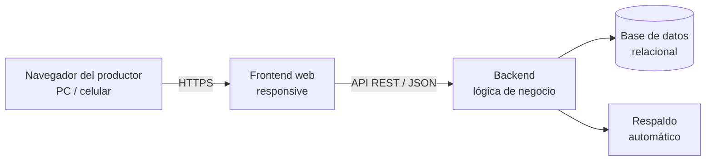

# 02 — Plan de Gestión del Proyecto

> Equivalente a la Actividad 3 de la guía de la cátedra.

## Índice

1. [Justificación de la metodología](#1-justificación-de-la-metodología)
2. [Ciclo de vida](#2-ciclo-de-vida)
3. [Recursos técnicos y humanos](#3-recursos-técnicos-y-humanos)
4. [Gestión de cambios](#4-gestión-de-cambios)
5. [Gestión de configuración](#5-gestión-de-configuración)
6. [Comunicación entre los stakeholders](#6-comunicación-entre-los-stakeholders)
7. [Elección de la versión del producto](#7-elección-de-la-versión-del-producto)
8. [Especificación del producto](#8-especificación-del-producto)
9. [Especificaciones técnicas](#9-especificaciones-técnicas)

---

## 1. Justificación de la metodología

El proyecto adopta un **enfoque híbrido**:

- **Gestión del proyecto:** marco de referencia del **PMI**. Hay alcance, cronograma, presupuesto y riesgos con línea base, e hitos formales que se informan al tutor.
- **Desarrollo del producto:** **iterativo e incremental**, con una adaptación liviana de **Scrum + Kanban** para un único desarrollador.

Por qué este enfoque:

- **Desarrollador único:** las ceremonias de Scrum pensadas para equipos (daily, retro grupal) no aportan valor. Se mantienen el backlog priorizado, las iteraciones con entregable y la revisión con el cliente.
- **Requisitos que se van a ajustar:** la propuesta aclara que los módulos están sujetos a cambios según el relevamiento. Iterar permite incorporar cambios al inicio de cada iteración sin rehacer trabajo.
- **Validación temprana con el productor:** cada iteración termina con una demo a Juan, que es quien mejor puede decir si la herramienta le sirve.
- **Rigor documental:** la Práctica Supervisada exige documentación y control formal, que aporta el marco PMI.

| Elemento | Aplicación en el proyecto |
|---|---|
| **Product Backlog** | Lista priorizada de historias de usuario ([ver HU](07-modelado/historias-de-usuario.md)), mantenida en un tablero Kanban (GitHub Projects). |
| **Iteración** | 2 semanas. Cada una cierra con un incremento funcional desplegado en el entorno de pruebas. |
| **Revisión con el cliente** | Demo al productor al cierre de cada iteración (presencial o videollamada). |
| **Tablero Kanban** | Columnas: *Backlog → Por hacer → En curso → En prueba → Hecho*. Límite de 2 tareas en curso. |
| **Product Owner** | Juan Pérez: define prioridades y valida los entregables. |
| **Equipo de desarrollo / PM** | Francisco Garcia Martinez. |
| **Supervisión** | Osvaldo Falabella (docente tutor). |
| **Definición de Hecho** | Código en `develop`, pruebas pasando, criterios de aceptación de la HU cumplidos y documentación actualizada. |

## 2. Ciclo de vida

### 2.1 Ciclo de vida del proyecto (PMI)

| Fase | Actividades | Entregables |
|---|---|---|
| **Inicio** | Propuesta, aceptación del establecimiento y del tutor | [Propuesta](01-propuesta.md) |
| **Planificación** | Relevamiento, alcance, requisitos, cronograma, presupuesto, riesgos, modelado | Documentos 02 a 09 |
| **Ejecución** | Desarrollo iterativo por módulos (etapas 3 a 6 del cronograma) | Incrementos funcionales |
| **Monitoreo y control** | Seguimiento semanal de avance contra el cronograma, revisión de riesgos en cada iteración | Informes de avance al tutor |
| **Cierre** | Pruebas finales, capacitación, entrega, documentación final, acta de aceptación del productor | Sistema en producción, manual de usuario, informe final |

### 2.2 Ciclo de vida del producto (iterativo e incremental)

### 2.3 Procesos de gestión

| Área | Cómo se gestiona |
|---|---|
| **Alcance** | Definido en el [alcance y requisitos](03-alcance-y-requisitos.md) y la [EDT](05-edt.md). Los cambios siguen el proceso de la [sección 4](#4-gestión-de-cambios). |
| **Cronograma** | [Cronograma](06-cronograma.md) con hitos. Se compara el avance real con el planificado cada semana. |
| **Costos** | [Presupuesto](08-presupuesto.md) por fase y por recurso. Se controlan las horas reales contra las estimadas. |
| **Riesgos** | [Registro de riesgos](09-riesgos.md), revisado al inicio de cada iteración. |
| **Calidad** | [Plan de pruebas](07-modelado/plan-de-pruebas.md) y criterios de aceptación por HU. |
| **Comunicaciones** | Según la [sección 6](#6-comunicación-entre-los-stakeholders). |

## 3. Recursos técnicos y humanos

### 3.1 Recursos humanos

| Rol | Persona | Responsabilidad |
|---|---|---|
| Project Manager / Analista / Desarrollador / Tester | Francisco Garcia Martinez | Planificación, relevamiento, diseño, desarrollo full stack, pruebas, despliegue, documentación y capacitación. |
| Product Owner / Usuario clave | Juan Pérez | Brindar información del negocio, priorizar, validar entregables y probar el sistema. |
| Docente tutor | Osvaldo Falabella | Supervisar, revisar entregables y aprobar la Práctica Supervisada. |
| Veterinario | Juan Pérez (el productor es veterinario) | Validar los requisitos de sanidad y reproducción. |

### 3.2 Recursos técnicos

| Recurso | Especificación |
|---|---|
| Equipo de desarrollo | PC del alumno (Windows 11) con IDE, Git y base de datos local. |
| Repositorio | GitHub (privado). |
| Gestión de tareas | GitHub Projects (tablero Kanban). |
| Documentación | Markdown en el repositorio (`docs/`). |
| Servidor de producción | Hosting en la nube con plan gratuito (ver [sección 9](#9-especificaciones-técnicas)). |
| Base de datos | Motor relacional (PostgreSQL como opción preferida). |
| Equipo del cliente | Computadora personal del productor con Windows y Google Chrome, buena conexión a internet e impresora. |

> ✅ **Validado en la entrevista** (bloque F). Usa Windows y Chrome, tiene buena conexión en su casa y tiene impresora.
>
> ⚠️ **Supuesto — a validar con el productor.** Tamaño de pantalla de la PC.

## 4. Gestión de cambios

1. **Solicitud:** cualquier cambio (del productor, el tutor o el alumno) se registra como *issue* en GitHub con la etiqueta `cambio`, describiendo qué y por qué.
2. **Análisis de impacto:** el alumno evalúa el impacto en alcance, horas, cronograma y riesgos.
3. **Decisión:** si afecta a una línea base (alcance, tiempo o costo), se consulta al tutor y se acuerda con el productor. Los cambios menores (textos, orden de campos) los aprueba directamente el productor en la demo.
4. **Registro:** se actualizan el backlog, la documentación afectada y su historial de versiones.

| Qué | Quién | Cómo | Cuándo | Dónde |
|---|---|---|---|---|
| Cambio en funcionalidades | Productor / Alumno | Issue + análisis de impacto | En la demo de cada iteración o cuando surja | GitHub + documento de alcance |
| Cambio en cronograma | Alumno, con aval del tutor | Replanificación | Ante desvíos mayores al 15% | [Cronograma](06-cronograma.md) |
| Cambio en una línea base | Alumno + Tutor + Productor | Solicitud de cambio formal | Cuando corresponda | Documento afectado + informe de avance |

## 5. Gestión de configuración

### 5.1 Propósito

Asegurar que el código, la documentación y la configuración estén siempre versionados, sean trazables y se puedan recuperar.

### 5.2 Estrategia de ramas (Git Flow simplificado)

| Rama | Uso |
|---|---|
| `main` | Versión en producción. Solo recibe merges desde `develop` al cerrar una versión. Cada release lleva una etiqueta `vX.Y.Z`. |
| `develop` | Integración. Versión estable del trabajo en curso, desplegada en el entorno de pruebas. |
| `feature/HU-xx-descripcion` | Una rama por historia de usuario. Se integra a `develop` mediante un Pull Request. |
| `hotfix/descripcion` | Correcciones urgentes sobre `main`. |

Como no hay revisión de código por pares (desarrollador único), cada Pull Request debe pasar las pruebas automatizadas y una **autorrevisión con checklist** antes del merge.

### 5.3 Ítems configurables

| Categoría | Ítems | Herramienta |
|---|---|---|
| Documentación | Documentos 00 a 09, modelado, manual de usuario | Git (`docs/`) |
| Código fuente | Frontend, backend, scripts de base de datos (migraciones) | Git / GitHub |
| Diseño | Mockups, diagramas | Git (Mermaid en `docs/07-modelado/`) |
| Infraestructura | Variables de entorno (sin secretos), configuración de despliegue | Git + panel del hosting |
| Pruebas | Casos de prueba, pruebas automatizadas, resultados | Git |
| Datos | Respaldos de la base de producción | Tarea programada gratuita que copia la base fuera del servidor |

## 6. Comunicación entre los stakeholders

| Comunicación | Destinatario | Frecuencia | Canal | Responsable |
|---|---|---|---|---|
| Demo de iteración | Productor | Cada 2 semanas | Presencial o videollamada | Alumno |
| Entrevistas de relevamiento | Productor (y veterinario) | Etapa 1, según necesidad | Presencial en el establecimiento / teléfono | Alumno |
| Consultas puntuales | Productor | Según necesidad | WhatsApp / teléfono | Alumno |
| Informe de avance | Docente tutor | Según lo pida la cátedra (mínimo mensual) | Email | Alumno |
| Consultas académicas | Docente tutor | Según necesidad | Email / presencial | Alumno |
| Notificación de incidentes en producción | Productor | Inmediata | WhatsApp / teléfono | Alumno |
| Capacitación | Productor (y personal) | Al cierre de cada módulo y al final | Presencial | Alumno |
| Entrega final | Productor y tutor | Al cierre | Presencial + repositorio | Alumno |

## 7. Elección de la versión del producto

Se adopta un desarrollo incremental por versiones.

### Versión 1.0 — Producto de la Práctica Supervisada

Aplicación **web**, pensada para usarse **en la computadora** del productor y **responsive** (también se ve bien en celular o tablet), con:

- Registro y seguimiento individual de animales, incluida la importación inicial desde planillas.
- Módulo de sanidad con plan sanitario y alertas de vencimientos.
- Módulo de reproducción: temporada de servicio, tactos, pariciones, abortos, destetes y celos (opcional).
- Carga por **jornada** (un mismo evento para muchos animales), pensada para pasar al sistema lo anotado en la manga.
- Reportes e índices: stock, preñez, parición, destete y mortandad, con exportación a PDF y Excel.
- Usuarios con roles.
- Respaldo de datos.

**Por qué web para PC y no una app móvil:**

| Factor | Situación del cliente | Implicancia |
|---|---|---|
| Momento de carga | Carga los datos en la computadora al llegar a su casa | La PC es el dispositivo principal |
| Uso del celular | No está acostumbrado y tiene un equipo viejo | Una app móvil sería difícil de adoptar y podría no funcionar en su equipo |
| Tipo de tarea | Planillas, listados largos, reportes | Se trabaja mejor en pantalla grande, con teclado y mouse |
| Distribución | — | La web no necesita instalación ni tiendas de aplicaciones |
| Futuro | El productor confirmó que por ahora alcanza con la web; más adelante podría hacer falta una versión móvil | Si la v1.0 es responsive y tiene una API separada, la PWA de la v2.0 se agrega sin reescribir |

### Versión 2.0 — Futura (fuera del alcance de la PS)

- **PWA instalable con carga offline** en la manga y sincronización al volver a tener señal.
- Lectura de caravanas electrónicas con bastón RFID. Sube de prioridad: el productor ya compra y vende con caravana electrónica.
- Integración con balanza electrónica.
- Notificaciones por email o WhatsApp de alertas.
- Integración o exportación hacia SIGSA / SENASA.
- Módulo económico (compras, ventas, costos).

## 8. Especificación del producto

| Módulo | Funcionalidades principales |
|---|---|
| **M1 — Usuarios y seguridad** | Inicio de sesión, recuperación de contraseña, ABM de usuarios, roles, auditoría. |
| **M2 — Animales** | Alta, modificación y baja; ficha con historial; búsqueda; categorías; pesadas; genealogía; importación desde planillas. |
| **M3 — Sanidad** | Vacunaciones y tratamientos (individuales o por jornada), casos de enfermedad, plan sanitario, períodos de retiro, alertas. |
| **M4 — Reproducción** | Temporada de servicio con toros en grupo, tacto, parición con alta de la cría, aborto, destete, alertas reproductivas, celo (opcional). |
| **M5 — Reportes** | Tablero de inicio, stock por categoría, índices reproductivos, mortandad, mortalidad y enfermedades de terneros, cobertura sanitaria, exportación. |
| **M6 — Configuración** | Datos del establecimiento, catálogos (razas, categorías, productos, toros y enfermedades), respaldo. |

El detalle está en el documento de [alcance y requisitos](03-alcance-y-requisitos.md#76-módulos).

## 9. Especificaciones técnicas

### 9.1 Arquitectura propuesta

Independientemente del lenguaje, se propone una **arquitectura web en tres capas** con API separada, para dejar preparada la evolución a PWA (v2.0):

- **Presentación:** frontend web responsive, priorizando el uso en PC.
- **Lógica de negocio:** API REST que concentra validaciones, reglas de negocio y cálculo de índices y alertas.
- **Datos:** base de datos relacional, porque el dominio es muy relacional (animal ↔ eventos ↔ catálogos) y hay que garantizar integridad.
- **Seguridad:** HTTPS, contraseñas con hash (bcrypt o Argon2), autenticación por sesión o token y autorización por rol.

### 9.2 Plataforma tecnológica — opciones evaluadas

> **Decisión: pendiente.** Se toma al cierre de la etapa 2 (hito H2), después del relevamiento.

| Criterio | Peso | .NET (ASP.NET Core + Blazor) | JS/TS (React/Next.js + Node) | Python (Django) |
|---|---|---|---|---|
| Experiencia previa del alumno | Alto | Alta: se usa en el Proyecto Final | A evaluar | A evaluar |
| Velocidad de desarrollo de ABM y formularios | Alto | Media | Media | Alta (admin y formularios incluidos) |
| Reportes PDF / Excel | Medio | Buenas librerías (QuestPDF, ClosedXML) | Buenas librerías | Buenas librerías (WeasyPrint, openpyxl) |
| Preparación para PWA (v2.0) | Medio | Blazor WASM soporta PWA | Excelente soporte PWA | Requiere un frontend aparte para offline |
| Costo de hosting (tiene que ser USD 0) | Excluyente | Hay planes gratuitos, con menos opciones | Muchos planes gratuitos | Hay planes gratuitos |
| Mantenibilidad a largo plazo | Medio | Alta (tipado fuerte) | Alta con TypeScript | Alta |
| Rendimiento en PC y conexión rural | Medio | Blazor WASM tiene una descarga inicial pesada; Blazor Server necesita conexión estable | Bueno | Bueno (render en servidor) |

**Base de datos:** se recomienda **PostgreSQL**. Es gratuita, robusta, está soportada por los tres stacks y tiene planes gestionados gratuitos.

**Hosting:** el cliente pidió costo de operación cero, así que se usan **solo planes gratuitos** para la aplicación y la base de datos. Hay que tener en cuenta sus límites: la aplicación puede "dormirse" sin uso y tardar en responder, hay topes de almacenamiento y algunas bases se pausan después de días sin actividad. Los respaldos se hacen con una tarea programada gratuita que guarda la copia fuera del proveedor. La elección depende del stack.

### 9.3 Criterios para la decisión

1. Experiencia del alumno, que permite cumplir las 230 hs.
2. Costo de operación cero: todo en planes gratuitos.
3. Facilidad de mantenimiento cuando termine la práctica.
4. Rendimiento con la conexión real del productor.

## Historial de versiones

| Versión | Fecha | Autor | Cambios |
|---|---|---|---|
| 0.1 | 2026-10-10 | Francisco Garcia Martinez | Versión inicial |
| 0.2 | 2026-10-10 | Francisco Garcia Martinez | El rol de veterinario lo cubre el productor (entrevista, bloque A) |
| 0.3 | 2026-10-10 | Francisco Garcia Martinez | Equipo del cliente validado (Windows, Chrome, buena conexión, impresora); potreros fuera de los módulos |
| 0.4 | 2026-10-10 | Francisco Garcia Martinez | Hosting gratuito (costo cero); módulos actualizados con casos de enfermedad, reporte de terneros y temporada de servicio |
| 0.5 | 2026-10-10 | Francisco Garcia Martinez | Lector RFID con más prioridad en la v2.0 (caravana electrónica en uso) |
| 0.6 | 2026-11-03 | Francisco Garcia Martinez | Datos del productor reemplazados por datos ficticios (nombre, establecimiento, ubicación, códigos SENASA y montos) para publicar el repositorio |
