# 05 — Estructura de Desglose del Trabajo (EDT)

> Equivalente a la plantilla 054 de la cátedra. Descompone el trabajo del proyecto en paquetes manejables. Las horas coinciden con las etapas de la propuesta (230 hs en total).

## Diagrama

```mermaid
flowchart TD
    P["Mi Hacienda Digital<br/>230 hs"]

    P --> E1["1. Relevamiento y análisis<br/>30 hs"]
    P --> E2["2. Diseño y arquitectura<br/>35 hs"]
    P --> E3["3. Módulo Animales<br/>50 hs"]
    P --> E4["4. Módulo Sanidad<br/>40 hs"]
    P --> E5["5. Módulo Reproducción<br/>35 hs"]
    P --> E6["6. Reportes y estadísticas<br/>25 hs"]
    P --> E7["7. Pruebas, implementación y cierre<br/>15 hs"]

    E1 --> E11[1.1 Entrevistas y observación]
    E1 --> E12[1.2 Documentación de gestión]
    E1 --> E13[1.3 Requisitos e historias de usuario]

    E2 --> E21[2.1 Elección de stack]
    E2 --> E22[2.2 Modelo de datos]
    E2 --> E23[2.3 Arquitectura y entorno]
    E2 --> E24[2.4 Mockups validados]

    E3 --> E31[3.1 Usuarios y seguridad]
    E3 --> E32[3.2 Catálogos y establecimiento]
    E3 --> E33[3.3 ABM y ficha de animal]
    E3 --> E34[3.4 Importación y jornadas]

    E4 --> E41[4.1 Vacunas y tratamientos]
    E4 --> E42[4.2 Plan sanitario]
    E4 --> E43[4.3 Alertas sanitarias]

    E5 --> E51[5.1 Celo, servicio y tacto]
    E5 --> E52[5.2 Parición, aborto y destete]
    E5 --> E53[5.3 Alertas reproductivas]

    E6 --> E61[6.1 Tablero y stock]
    E6 --> E62[6.2 Índices y mortandad]
    E6 --> E63[6.3 Exportación y respaldo]

    E7 --> E71[7.1 Pruebas de aceptación]
    E7 --> E72[7.2 Despliegue y capacitación]
    E7 --> E73[7.3 Documentación final]
```

## Diccionario de la EDT

| Código | Paquete de trabajo | Entregable | Horas | RF / Documento |
|---|---|---|---|---|
| **1** | **Relevamiento y análisis de requisitos** | | **30** | |
| 1.1 | Entrevistas al productor (y veterinario) y observación de una jornada en la manga | Guía de entrevista respondida, minutas | 10 | [Guía](relevamiento/guia-entrevista-productor.md) |
| 1.2 | Documentación de gestión: propuesta, plan, cronograma, presupuesto y riesgos | Documentos 01, 02, 06, 08, 09 | 10 | 01, 02, 06, 08, 09 |
| 1.3 | Requisitos, reglas de negocio, historias de usuario, matriz de trazabilidad | Documentos 03, 04, HU validadas | 10 | 03, 04, HU |
| **2** | **Diseño de base de datos y arquitectura** | | **35** | |
| 2.1 | Evaluación y elección del stack y del hosting | Decisión documentada en el plan, sección 9 | 5 | RNF-012, RNF-013 |
| 2.2 | DER, diccionario de datos y diagrama de clases | DER y clases | 10 | [DER](07-modelado/der.md), [Clases](07-modelado/diagrama-de-clases.md) |
| 2.3 | Estructura del proyecto, repositorio, entornos, CI y despliegue de prueba | Proyecto base desplegado ("hola mundo") | 12 | RNF-006, RNF-008 |
| 2.4 | Mockups y validación con el productor | Mockups aprobados | 8 | [Mockups](07-modelado/mockups.md) |
| **3** | **Módulo de gestión de animales** | | **50** | |
| 3.1 | Inicio de sesión, recuperación, usuarios, roles, auditoría | Incremento 1 | 12 | RF-001 a RF-004 |
| 3.2 | Catálogos y datos del establecimiento | Incremento 1 | 6 | RF-035, RF-036 |
| 3.3 | Alta, modificación, baja, búsqueda, ficha, categorías, pesadas, genealogía | Incremento 2 | 20 | RF-005 a RF-013 |
| 3.4 | Importación desde planilla y carga por jornada | Incremento 2 | 12 | RF-014, RF-015 |
| **4** | **Módulo de sanidad** | | **40** | |
| 4.1 | Vacunaciones, tratamientos, períodos de retiro, historial | Incremento 3 | 16 | RF-016, RF-017, RF-020 |
| 4.2 | Plan sanitario anual | Incremento 3 | 10 | RF-018 |
| 4.3 | Alertas sanitarias | Incremento 3 | 14 | RF-019 |
| **5** | **Módulo de reproducción** | | **35** | |
| 5.1 | Temporada de servicio, tactos con período de parición, celos (opcional) | Incremento 4 | 13 | RF-021 a RF-023 |
| 5.2 | Pariciones con alta de cría, abortos, destetes | Incremento 4 | 14 | RF-024 a RF-026 |
| 5.3 | Alertas reproductivas | Incremento 4 | 8 | RF-027 |
| **6** | **Reportes y estadísticas** | | **25** | |
| 6.1 | Tablero de inicio y stock | Incremento 5 | 8 | RF-028, RF-034 |
| 6.2 | Índices reproductivos, mortandad, cobertura sanitaria, filtros | Incremento 5 | 11 | RF-029 a RF-032 |
| 6.3 | Exportación a PDF/Excel y respaldo | Incremento 5 | 6 | RF-033, RF-037 |
| **7** | **Pruebas, ajustes y documentación final** | | **15** | |
| 7.1 | Pruebas de aceptación con el productor y pruebas no funcionales | Informe de pruebas | 6 | [Plan de pruebas](07-modelado/plan-de-pruebas.md) |
| 7.2 | Despliegue en producción, migración de datos y capacitación | Sistema en producción, capacitación | 5 | RNF-004 |
| 7.3 | Manual de usuario, informe final y acta de aceptación | Documentación final | 4 | — |
| | **TOTAL** | | **230** | |

> Las pruebas unitarias y de integración se hacen **dentro** de cada etapa de desarrollo (3 a 6) y están incluidas en sus horas. La etapa 7 cubre las pruebas de aceptación y no funcionales finales.

## Historial de versiones

| Versión | Fecha | Autor | Cambios |
|---|---|---|---|
| 0.1 | 2026-10-10 | Francisco Garcia Martinez | Versión inicial |
| 0.2 | 2026-10-10 | Francisco Garcia Martinez | Sin movimientos entre potreros (excluidos de la v1.0) |
| 0.3 | 2026-11-03 | Francisco Garcia Martinez | Nombre del proyecto: Mi Hacienda Digital (antes Mi Yerra Digital) |
