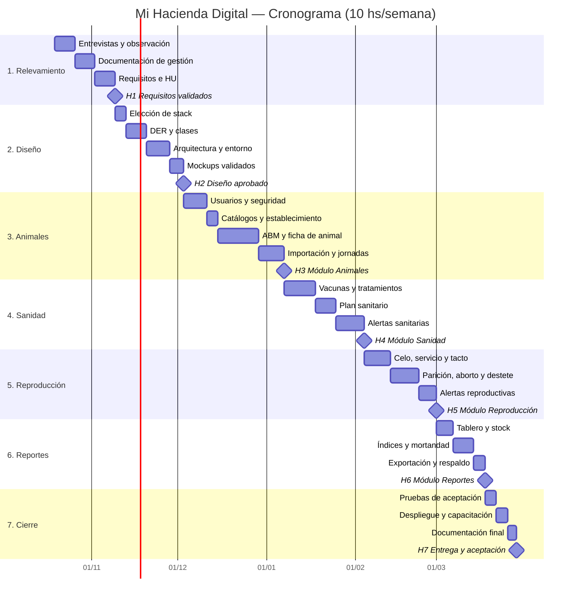

# 06 — Cronograma del Proyecto

> Equivalente a la plantilla 066 de la cátedra. Basado en las 7 etapas y 230 horas de la propuesta de PS.

## 1. Supuestos de planificación

| Supuesto | Valor |
|---|---|
| Dedicación semanal | **10 horas por semana** ⚠️ (ajustar según la carga de cursada del alumno) |
| Fecha de inicio | **Lunes 19/10/2026** ⚠️ (provisoria) |
| Duración total | 230 hs ÷ 10 hs/sem = **23 semanas** |
| Iteraciones de desarrollo | 2 semanas, con demo al productor al cierre |
| Dependencias | Las etapas son secuenciales. Cada módulo se apoya en el anterior (sanidad y reproducción necesitan animales; los reportes necesitan todos los datos). |

> El cronograma no descuenta feriados ni recesos (fiestas de fin de año, vacaciones de verano). Si se toma receso, las fechas se corren la misma cantidad de semanas. La propuesta original no fija fechas: estas son solo de referencia para el seguimiento.

## 2. Etapas

| Etapa | Descripción | Horas | Semanas | Inicio | Fin |
|---|---|---|---|---|---|
| 1 | Relevamiento y análisis de requerimientos con el productor | 30 | 3 | 19/10/2026 | 08/11/2026 |
| 2 | Diseño de base de datos y arquitectura de la aplicación | 35 | 3,5 | 09/11/2026 | 02/12/2026 |
| 3 | Desarrollo del módulo de gestión de animales (altas, bajas, seguimiento) | 50 | 5 | 03/12/2026 | 06/01/2027 |
| 4 | Desarrollo del módulo de sanidad y registros veterinarios | 40 | 4 | 07/01/2027 | 03/02/2027 |
| 5 | Desarrollo del módulo de reproducción y pariciones | 35 | 3,5 | 04/02/2027 | 28/02/2027 |
| 6 | Desarrollo de reportes y estadísticas | 25 | 2,5 | 01/03/2027 | 17/03/2027 |
| 7 | Pruebas, ajustes y documentación final | 15 | 1,5 | 18/03/2027 | 28/03/2027 |
| | **TOTAL** | **230** | **23** | | |

## 3. Diagrama de Gantt

## 4. Hitos

| Hito | Descripción | Fecha estimada | Criterio de cumplimiento |
|---|---|---|---|
| **H1** | Requisitos validados | 08/11/2026 | El productor revisó y aprobó los requisitos y las HU. Los supuestos ⚠️ críticos están resueltos. |
| **H2** | Diseño aprobado | 02/12/2026 | Stack elegido, DER cerrado, mockups aprobados por el productor, proyecto base desplegado. |
| **H3** | Módulo Animales | 06/01/2027 | RF-001 a RF-015, RF-035 y RF-036 probados. El rodeo actual está importado en el entorno de pruebas. |
| **H4** | Módulo Sanidad | 03/02/2027 | RF-016 a RF-020 probados y validados en una demo. |
| **H5** | Módulo Reproducción | 28/02/2027 | RF-021 a RF-027 probados y validados en una demo. |
| **H6** | Módulo Reportes | 17/03/2027 | RF-028 a RF-034 y RF-037 probados. Los índices coinciden con un cálculo manual de control. |
| **H7** | Entrega y aceptación | 28/03/2027 | Sistema en producción, productor capacitado, acta de aceptación firmada, documentación final entregada. |

## 5. Iteraciones

| Iteración | Semanas | Contenido principal | Demo |
|---|---|---|---|
| — | 1–7 | Relevamiento y diseño (etapas 1 y 2) | Validación de requisitos y mockups |
| I1 | 8–9 | Usuarios, catálogos, inicio del ABM de animales | Inicio de sesión y catálogos |
| I2 | 10–11 | ABM, ficha, búsqueda, pesadas | Ficha del animal |
| I3 | 12–13 | Importación y jornadas | Importación del rodeo real |
| I4 | 14–15 | Vacunas, tratamientos, plan sanitario | Carga de una vacunación real |
| I5 | 16–17 | Alertas sanitarias, servicios, tactos | Alertas en el tablero |
| I6 | 18–19 | Pariciones, destetes, alertas reproductivas | Carga de una parición real |
| I7 | 20–21 | Tablero, stock, índices, exportación | Reportes con datos reales |
| I8 | 22–23 | Pruebas de aceptación, despliegue, capacitación | Entrega |

## 6. Seguimiento

- Las horas reales se registran semanalmente por paquete de la [EDT](05-edt.md).
- Si el desvío acumulado supera el 15%, se replanifica según la [gestión de cambios](02-plan-del-proyecto.md#4-gestión-de-cambios).
- Los informes de avance usan la técnica del valor ganado, como pide la cátedra (VP = valor planificado, VG = valor ganado, CR = costo real, en horas).

## Historial de versiones

| Versión | Fecha | Autor | Cambios |
|---|---|---|---|
| 0.1 | 2026-10-10 | Francisco Garcia Martinez | Versión inicial |
| 0.2 | 2026-10-10 | Francisco Garcia Martinez | Sin movimientos entre potreros (excluidos de la v1.0) |
| 0.3 | 2026-11-03 | Francisco Garcia Martinez | Nombre del proyecto: Mi Hacienda Digital (antes Mi Yerra Digital) |
