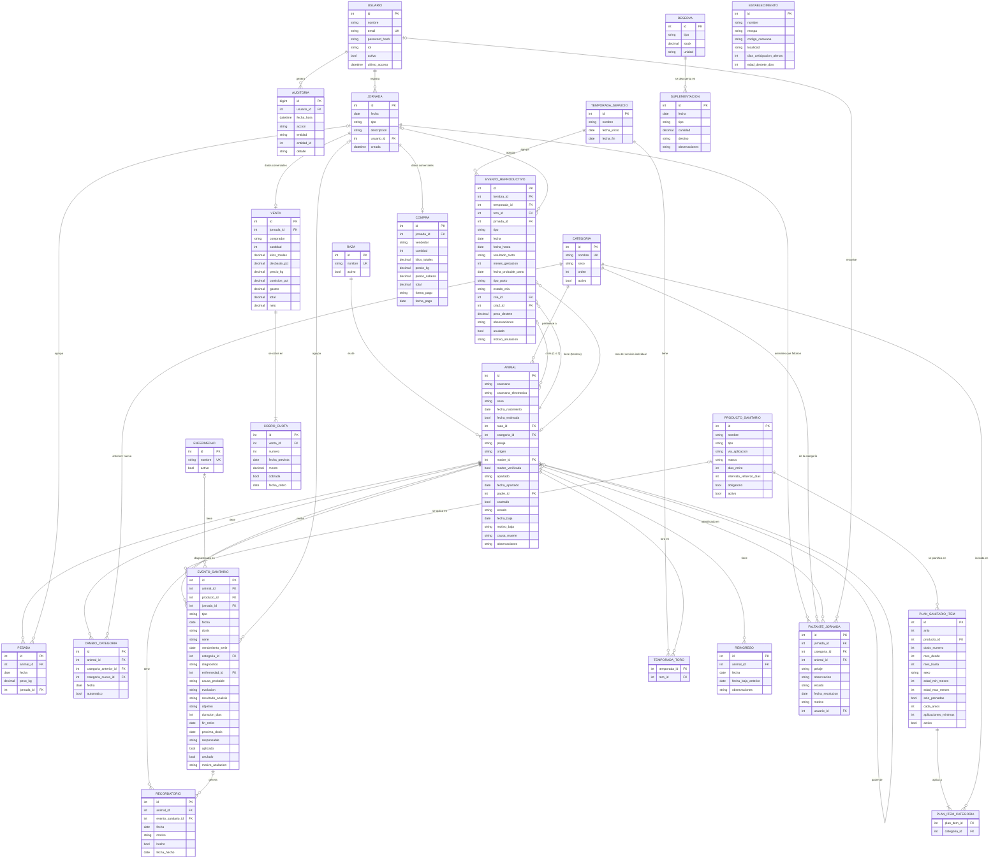

# Diagrama Entidad-Relación (DER)

> Anexo 1, punto 2 de la guía de la cátedra. Entrega incremental: esta versión cubre los módulos M1 a M6 de la v1.0.

## Decisiones de diseño

- **Eventos separados por dominio:** los eventos sanitarios y reproductivos tienen atributos muy distintos, así que van en tablas separadas (`EVENTO_SANITARIO`, `EVENTO_REPRODUCTIVO`). Las pesadas y los cambios de categoría también tienen tabla propia.
- **Jornada:** agrupa eventos cargados en una misma operación sobre varios animales (RF-015). Cada evento puede pertenecer, opcionalmente, a una jornada.
- **Sin borrado físico (RNF-014):** los animales tienen `estado` y datos de baja. Los eventos tienen `anulado`, `motivo_anulacion` y `anulado_por`.
- **Toros:** un toro es un `ANIMAL` macho del establecimiento. Como los toros están en grupo con las vacas, se registran **por temporada** (`TEMPORADA_TORO`) y no por servicio. La genealogía apunta a `ANIMAL` (madre y, si se conoce, padre). No hay inseminación artificial en la v1.0.
- **Enfermedades:** los casos de enfermedad son eventos sanitarios de tipo `ENFERMEDAD`, con la enfermedad del catálogo, la causa probable y la evolución. El producto es opcional (si hubo tratamiento).
- **Alertas:** se **calculan** a partir de los eventos y del plan sanitario, sin guardarse en una tabla. Así se evita mantener datos desincronizados. Si hiciera falta por rendimiento, se agregaría una tabla de caché.
- **Cuaderno del productor (2026-11-03):** se agregaron mellizos (`cria2_id`), servicio individual (`toro_id`), animales apartados, cuotas de cobro (`COBRO_CUOTA`) y alimentación con stock de reservas (`SUPLEMENTACION`, `RESERVA`).
- **Recordatorios:** los avisos de seguimiento (por ejemplo, revisar un animal tratado a los 3 días) se guardan en `RECORDATORIO`. A diferencia de las alertas del plan, no se calculan: los crea el usuario.
- **Animales que faltaron (RN-027):** en una vacunación o desparasitación por categoría, cada animal que no se vacunó o desparasitó es una fila de `FALTANTE_JORNADA`, con `animal_id` si está identificado y, si no, con categoría y pelaje y observación opcionales. Una carga de "3 vacas" crea 3 filas. El excluido por caravana no recibe evento; el resto de la categoría sí. Al identificar un faltante se completa `animal_id` y su evento de esa jornada pasa a `aplicado = false`. El aviso sigue mientras `estado = PENDIENTE`, y los cambios quedan en `AUDITORIA`.
- **Compras:** igual que las ventas, una jornada de compra da de alta varios animales y guarda los datos comerciales en `COMPRA`.
- **Ventas:** cada jornada de venta tiene una fila en `VENTA` con los datos comerciales (comprador, kilos, precio, cobro). Los animales vendidos quedan con una `PESADA` marcada como promedio (RN-020). El resto de la gestión económica no se modela.
- **Reingresos:** un animal trasladado que vuelve se reactiva (mismo registro) y el reingreso queda en `REINGRESO` (RN-019).
- **Plan sanitario con condiciones:** cada ítem tiene ventana de meses, una o más categorías (`PLAN_ITEM_CATEGORIA`) y condiciones opcionales de sexo, edad y preñez, para representar el [plan real de Los Álamos](../relevamiento/plan-sanitario-establecimiento.md).
- **Una sola caravana:** el productor usa solo la oficial de SENASA, así que no hay campo de caravana interna. Es opcional porque los terneros se caravanean al destete.
- **Un establecimiento:** la tabla `ESTABLECIMIENTO` existe para guardar datos y configuración. Las demás tablas no llevan clave de establecimiento, porque el sistema no es multi-empresa en la v1.0.

## Diagrama

## Diccionario de datos (atributos con dominio restringido)

| Entidad.atributo | Dominio | Notas |
|---|---|---|
| `USUARIO.rol` | `ADMINISTRADOR`, `VETERINARIO`, `PEON`, `CONSULTA` | Ver [roles y permisos](roles-y-permisos.md) |
| `ANIMAL.sexo` | `M`, `H` | |
| `ANIMAL.origen` | `NACIDO`, `COMPRADO`, `OTRO` | |
| `ANIMAL.estado` | `ACTIVO`, `BAJA` | |
| `ANIMAL.motivo_baja` | `VENTA`, `MUERTE`, `TRASLADO`, `OTRO` | `causa_muerte` solo si es `MUERTE`. `TRASLADO` es el pase a otro campo del productor |
| `ANIMAL.caravana` | Texto, opcional | Caravana oficial de SENASA, formato `AA999A999` en mayúsculas y sin espacios (RN-013). Única entre animales `ACTIVO` (RN-001): índice único parcial. Vacía en los terneros al pie hasta el destete. Los 5 primeros caracteres son el código del establecimiento de origen |
| `ESTABLECIMIENTO.codigo_caravana` | `AA999` | Primera parte de la caravana SENASA de los animales nacidos en el campo (AB123). Se completa sola al caravanear |
| `PRODUCTO_SANITARIO.via_aplicacion` | `INYECTABLE`, `POUR_ON`, `BANO_ASPERSION`, `ORAL`, `OTRA` | |
| `EVENTO_SANITARIO.objetivo` | `INTERNOS`, `MOSCA`, `PIOJO`, `SARNA`, `OTRO` | Solo en `DESPARASITACION` |
| `PLAN_SANITARIO_ITEM.aplicaciones_minimas` | Entero ≥ 1 | Aplicaciones que hay que completar en la ventana (RN-022) |
| `ANIMAL.caravana_electronica` | Texto, opcional | Número de la caravana electrónica de SENASA. Único entre animales `ACTIVO`. Se carga a mano (sin lector en la v1.0) ⚠️ formato a validar |
| `ANIMAL.madre_verificada` | Booleano | `false` cuando el ternero se destetó o vendió por grupo y no se sabe si `madre_id` es correcta (RN-018) |
| `ANIMAL.castrado` | Booleano | Se marca con la jornada de castración; `false` en el que queda para toro |
| `PLAN_SANITARIO_ITEM.mes_desde`, `mes_hasta` | 1 a 12 | Ventana de aplicación. Si `mes_hasta` < `mes_desde`, cruza el año (por ejemplo, 12 a 1) |
| `PLAN_SANITARIO_ITEM.sexo` | `M`, `H` o vacío | Vacío significa ambos sexos |
| `ANIMAL.fecha_estimada` | Booleano | `true` si la fecha se calculó a partir de una edad estimada |
| `CATEGORIA.sexo` | `M`, `H`, `AMBOS` | Valores iniciales: Ternero, Ternera, Vaquillona, Vaca, Novillito, Novillo, Toro |
| `PRODUCTO_SANITARIO.tipo` | `VACUNA`, `ANTIPARASITARIO`, `ANTIBIOTICO`, `VITAMINA`, `ANALISIS`, `OTRO` | |
| `EVENTO_SANITARIO.tipo` | `VACUNACION`, `TRATAMIENTO`, `DESPARASITACION`, `ENFERMEDAD`, `ANALISIS` | `ANALISIS` usa `producto_id` (raspaje, sangrado) y `resultado_analisis`. `ENFERMEDAD` usa `enfermedad_id`, `causa_probable` y `evolucion`; el producto es opcional |
| `EVENTO_SANITARIO.resultado_analisis` | `NEGATIVO`, `POSITIVO`, `SOSPECHOSO` | Solo en `ANALISIS`. `POSITIVO` genera alerta |
| `PLAN_SANITARIO_ITEM.cada_anios` | 1 o 2 | 2 = año por medio (sangrado) |
| `VENTA.total` | Decimal | Bruto: `kilos_totales` × (1 − `desbaste_pct`) × `precio_kg`. `neto` = total − comisión − `gastos`. Peso promedio = kilos netos ÷ `cantidad` (RN-020) |
| `COBRO_CUOTA.cobrada` | Booleano | La venta está cobrada cuando todas sus cuotas lo están (RN-026) |
| `ANIMAL.apartado` | `VENTA`, `DESCARTE` o vacío | Animales apartados (RF-045) |
| `SUPLEMENTACION.tipo` | `ROLLO`, `SILO`, `PARCELA`, `OTRO` | `ROLLO` y `SILO` descuentan de `RESERVA` (RF-046) |
| `EVENTO_SANITARIO.serie` | Texto, opcional | Serie del producto (lo que antes se llamaba lote) |
| `EVENTO_SANITARIO.vencimiento_serie` | Fecha, opcional | Vencimiento de la serie de la vacuna |
| `PRODUCTO_SANITARIO.marca` | Texto | Marca o laboratorio. Con la serie, permite saber con qué se vacunó |
| `RECORDATORIO.hecho` | Booleano | El recordatorio se muestra en Pendientes desde `fecha` hasta que `hecho` es verdadero (RN-024) |
| `EVENTO_SANITARIO.categoria_id` | FK | Categoría por la que se vacunó al animal en una vacunación masiva (RN-023). La dosis no se usa en las vacunaciones |
| `EVENTO_SANITARIO.aplicado` | Booleano | `true` por defecto. Pasa a `false` cuando un animal sin identificar se identifica como faltante de la jornada (RN-027): sigue en el historial como "no aplicado" y no cuenta en la cobertura |
| `FALTANTE_JORNADA.animal_id` | Opcional | Nulo mientras esté sin identificar. Identificarlo no cierra el aviso. Las filas sin identificar de una categoría no pueden superar los animales de esa categoría en la jornada menos los excluidos por caravana (RN-027) |
| `FALTANTE_JORNADA.pelaje`, `observacion` | Opcionales | Datos para reconocer al animal después ("colorado", "la que estaba renga"). Se pueden corregir mientras siga `PENDIENTE` |
| `FALTANTE_JORNADA.estado` | `PENDIENTE`, `VACUNADO_DESPUES`, `CERRADO` | El aviso sigue en Pendientes mientras sea `PENDIENTE`. `VACUNADO_DESPUES` (también para desparasitaciones) lleva `fecha_resolucion` y, si tiene `animal_id`, crea su evento individual. `CERRADO` requiere `motivo` |
| `EVENTO_SANITARIO.evolucion` | `EN_CURSO`, `RECUPERADO`, `MUERTO` | `MUERTO` → baja por muerte con la enfermedad como causa |
| `ENFERMEDAD.nombre` | Texto | Valores iniciales: Diarrea, Neumonía, Ombligo, Otra |
| `EVENTO_REPRODUCTIVO.tipo` | `CELO`, `SERVICIO`, `TACTO`, `PARICION`, `ABORTO`, `DESTETE` | Los atributos usados dependen del tipo (ver abajo) |
| `EVENTO_REPRODUCTIVO.resultado_tacto` | `PRENADA`, `VACIA` | |
| `EVENTO_REPRODUCTIVO.tipo_parto` | `NORMAL`, `ASISTIDO`, `CESAREA` | |
| `EVENTO_REPRODUCTIVO.estado_cria` | `VIVA`, `MUERTA` | `VIVA` → se crea la cría y se completa `cria_id` (RN-005). `MUERTA` cuenta en la mortalidad de terneros (RN-016) |
| `JORNADA.tipo` | `VACUNACION`, `TRATAMIENTO`, `TACTO`, `SERVICIO`, `PESADA`, `DESTETE`, `VENTA`, `ENFERMEDAD`, `ANALISIS`, `COMPRA`, `CASTRACION`, `ALIMENTACION` | |

### Atributos usados por cada tipo de evento reproductivo

| Tipo | Atributos |
|---|---|
| `CELO` | fecha, observaciones |
| `SERVICIO` | fecha y fecha_hasta (entrada y salida de los toros), temporada_id. Los toros están en `TEMPORADA_TORO`. Excepción: servicio individual de una hembra con `toro_id` y fecha (RN-004) |
| `TACTO` | fecha, resultado_tacto, meses_gestacion (opcional), fecha_probable_parto (solo si hay meses de gestación; si no, se usa el período de parición de la temporada, RN-008) |
| `PARICION` | fecha, tipo_parto, estado_cria, cria_id y, si son mellizos, cria2_id |
| `ABORTO` | fecha, observaciones |
| `DESTETE` | fecha, cria_id (el ternero destetado), peso_destete |

> **Alternativa a evaluar en la etapa 2:** dividir `EVENTO_REPRODUCTIVO` en una tabla por tipo (herencia tabla-por-tipo) si los campos nulos complican las validaciones. Se decide según el ORM y el stack elegido.

## Historial de versiones

| Versión | Fecha | Autor | Cambios |
|---|---|---|---|
| 0.1 | 2026-10-10 | Francisco Garcia Martinez | Versión inicial |
| 0.2 | 2026-10-10 | Francisco Garcia Martinez | Rol `ENCARGADO` renombrado a `PEON` |
| 0.3 | 2026-10-10 | Francisco Garcia Martinez | Sin `POTRERO` ni `MOVIMIENTO` (potreros fuera de la v1.0); motivo de baja `TRASLADO` |
| 0.4 | 2026-10-10 | Francisco Garcia Martinez | Sin `caravana_oficial` (una sola caravana, opcional); plan sanitario con ventana de meses, condiciones y `PLAN_ITEM_CATEGORIA` |
| 0.5 | 2026-10-10 | Francisco Garcia Martinez | Sin `PAJUELA` ni toro por servicio: `TEMPORADA_TORO`; `ENFERMEDAD` y casos de enfermedad en `EVENTO_SANITARIO`; jornadas de venta y enfermedad |
| 0.6 | 2026-10-10 | Francisco Garcia Martinez | `VENTA` (datos comerciales y cobro), `REINGRESO`, caravana electrónica, madre verificada, análisis con resultado, frecuencia en años del plan |
| 0.7 | 2026-10-10 | Francisco Garcia Martinez | `COMPRA`, código de caravana del establecimiento, vía de aplicación, objetivo de la desparasitación y aplicaciones mínimas del plan |
| 0.8 | 2026-10-10 | Francisco Garcia Martinez | `lote_producto` pasa a `serie`; categoría de la vacunación masiva |
| 0.9 | 2026-10-10 | Francisco Garcia Martinez | `RECORDATORIO`; marca del producto y vencimiento de la serie |
| 0.10 | 2026-11-03 | Francisco Garcia Martinez | Mellizos, servicio individual, apartados, desbaste/comisión/neto, `COBRO_CUOTA`, forma de pago, `SUPLEMENTACION` y `RESERVA`, ombligo, jornadas de castración y alimentación |
| 0.11 | 2026-11-03 | Francisco Garcia Martinez | Datos del productor reemplazados por datos ficticios (nombre, establecimiento, ubicación, códigos SENASA y montos) para publicar el repositorio |
| 0.12 | 2026-11-04 | Francisco Garcia Martinez | Faltantes sin identificar en vacunaciones y desparasitaciones (RN-027): `FALTANTE_JORNADA`, `FALTANTE_RESOLUCION` y `EVENTO_SANITARIO.aplicado` |
| 0.13 | 2026-11-06 | Francisco Garcia Martinez | `FALTANTE_JORNADA` pasa a una fila por animal, con `animal_id`, `pelaje`, `observacion` y `estado`; se elimina `FALTANTE_RESOLUCION` (RN-027) |
