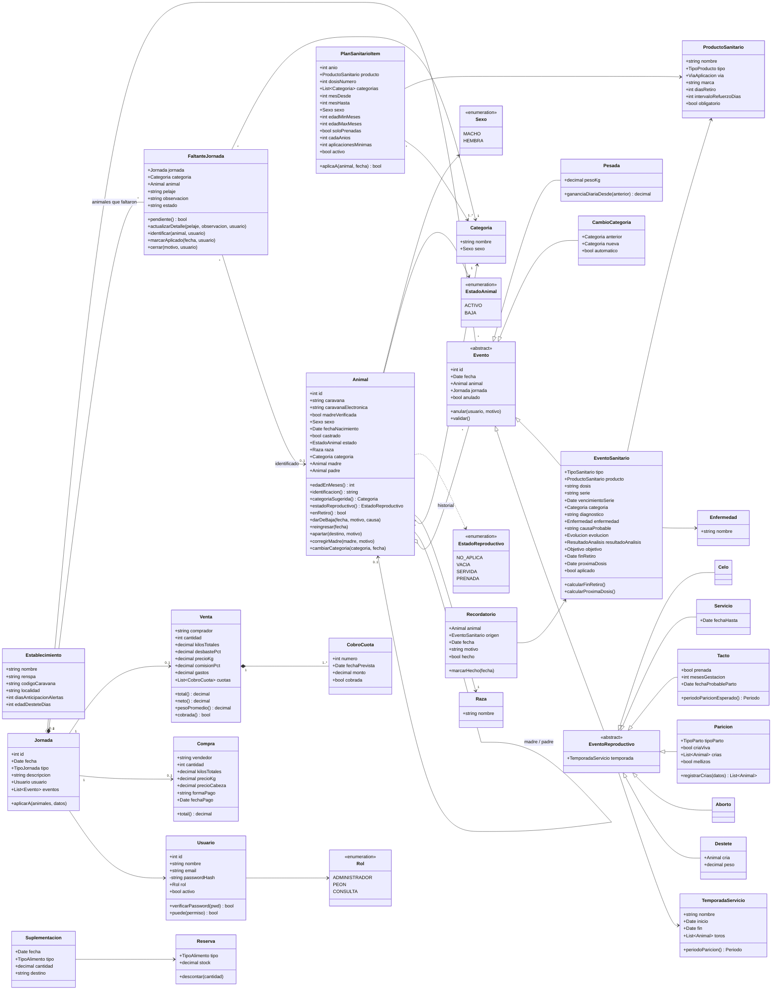
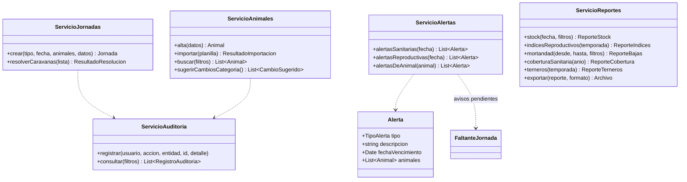

# Diagrama de Clases

> Anexo 1, punto 3 de la guía de la cátedra. Entrega incremental. Modelo de dominio independiente del lenguaje: los tipos y la sintaxis definitivos se escriben en TypeScript, el lenguaje del stack elegido.

## Modelo de dominio

## Servicios de aplicación

Clases que concentran la lógica que cruza varias entidades.

## Notas

- `Animal.categoriaSugerida()` implementa la RN-006 y `Tacto.calcularFechaProbableParto()` la RN-008.
- `Paricion.registrarCria()` implementa la RN-005: crea el `Animal` cría con madre, padre (del último `Servicio`) y categoría Ternero o Ternera.
- `Evento.validar()` aplica la RN-002 (animal activo), la RN-003 (solo hembras en eventos reproductivos) y la RN-007 (fechas válidas).
- `Evento.anular()` implementa la RNF-014 y la RN-011 (solo el administrador, con auditoría).
- `FaltanteJornada` implementa la RN-027: cada animal que no se vacunó o desparasitó, identificado o no. `identificar()` completa `animal` y marca `aplicado = false` en su `EventoSanitario` de la jornada (no es una anulación: lo puede hacer quien carga vacunas, con auditoría), pero no cierra el aviso. `marcarAplicado()` y `cerrar()` lo cierran. `pendiente()` alimenta el aviso de `ServicioAlertas` y la cobertura.

## Historial de versiones

| Versión | Fecha | Autor | Cambios |
|---|---|---|---|
| 0.1 | 2026-10-10 | Francisco Garcia Martinez | Versión inicial |
| 0.2 | 2026-10-10 | Francisco Garcia Martinez | Rol `ENCARGADO` renombrado a `PEON` |
| 0.3 | 2026-10-10 | Francisco Garcia Martinez | Sin `Potrero` ni `Movimiento` (potreros fuera de la v1.0) |
| 0.4 | 2026-10-10 | Francisco Garcia Martinez | Sin `caravanaOficial`; `identificacion()` para terneros sin caravana; `PlanSanitarioItem` con ventana y condiciones |
| 0.5 | 2026-10-10 | Francisco Garcia Martinez | Sin `Pajuela`; toros por temporada; período de parición; `Enfermedad` y casos en `EventoSanitario`; reporte de terneros |
| 0.6 | 2026-10-10 | Francisco Garcia Martinez | `Venta`, reingreso, caravana electrónica, madre verificada, resultado de análisis y frecuencia del plan |
| 0.7 | 2026-10-10 | Francisco Garcia Martinez | `Compra`, código de caravana, vía de aplicación, objetivo de desparasitación y aplicaciones mínimas |
| 0.8 | 2026-10-10 | Francisco Garcia Martinez | `loteProducto` pasa a `serie`; categoría de la vacunación |
| 0.9 | 2026-10-10 | Francisco Garcia Martinez | `Recordatorio`; marca y vencimiento de la serie |
| 0.10 | 2026-11-03 | Francisco Garcia Martinez | Parición con 1 o 2 crías, `CobroCuota`, desbaste y comisión en `Venta`, forma de pago, `Suplementacion` y `Reserva`, apartar y corregir madre |
| 0.11 | 2026-11-04 | Francisco Garcia Martinez | `FaltanteJornada` y `EventoSanitario.aplicado` (RN-027: animales que faltaron vacunar o desparasitar sin identificar) |
| 0.12 | 2026-11-06 | Francisco Garcia Martinez | `FaltanteJornada` por animal, con pelaje, observación y estado; `actualizarDetalle()` y `marcarAplicado()` (RN-027) |
| 0.13 | 2026-11-06 | Francisco Garcia Martinez | Tipos y sintaxis definitivos en TypeScript, por el stack elegido |
| 0.14 | 2026-11-06 | Francisco Garcia Martinez | Se quita `VETERINARIO` del enumerado `Rol` |
