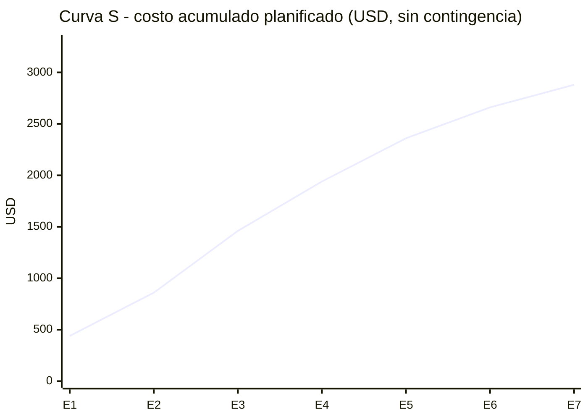

# 08 — Presupuesto del Proyecto

> Equivalente a las plantillas 073 de la cátedra (por fase y entregable, por tipo de recurso y curva S).

## 1. Consideraciones

- El desarrollo se hace en el marco de una **Práctica Supervisada**: el alumno no cobra honorarios. Igual se valoriza la mano de obra, para conocer **el costo real del proyecto** y como referencia si se cotizara comercialmente.
- Los montos están en **dólares estadounidenses (USD)** para evitar el efecto de la inflación. Para pasarlos a pesos se usa el tipo de cambio del día de la presentación.
- **Valor hora de referencia:** USD 12/h, desarrollador junior/semi-senior freelance en Argentina. ⚠️ Ajustar con una fuente actualizada (por ejemplo, encuestas salariales del sector o tarifas del CPCI) antes de presentarlo.

> ⚠️ **Supuesto — a validar.** Valor hora y cantidad de viajes al establecimiento. El hosting es gratuito: el cliente pidió costo de operación cero (validado en la entrevista).

## 2. Presupuesto por fase y entregable

| Etapa | Entregable | Horas | Mano de obra (USD) | Otros costos (USD) | Total (USD) |
|---|---|---|---|---|---|
| 1 | Requisitos validados, documentación de gestión | 30 | 360 | 80 (2 viajes) | 440 |
| 2 | Diseño, stack, entorno base, mockups | 35 | 420 | 0 | 420 |
| 3 | Módulo Animales | 50 | 600 | 0 | 600 |
| 4 | Módulo Sanidad | 40 | 480 | 0 | 480 |
| 5 | Módulo Reproducción | 35 | 420 | 0 | 420 |
| 6 | Módulo Reportes | 25 | 300 | 0 | 300 |
| 7 | Pruebas, despliegue, capacitación, documentación final | 15 | 180 | 40 (1 viaje) | 220 |
| | **Subtotal** | **230** | **2.760** | **120** | **2.880** |
| | Reserva de contingencia (10%) | | | | 288 |
| | **TOTAL DEL PROYECTO** | | | | **3.168** |

## 3. Presupuesto por tipo de recurso

| Tipo de recurso | Detalle | Cantidad | Costo unitario (USD) | Total (USD) |
|---|---|---|---|---|
| **Recursos humanos** | Analista / desarrollador / tester / PM | 230 h | 12 | 2.760 |
| **Infraestructura** | Hosting de aplicación + base de datos, plan gratuito | 6 meses | 0 | 0 |
| | Dominio: se usa el subdominio gratuito del proveedor | — | 0 | 0 |
| **Software** | IDE, Git, GitHub, librerías open source | — | 0 | 0 |
| **Viáticos** | Viajes al establecimiento (relevamiento, demo, capacitación) ⚠️ | 3 | 40 | 120 |
| **Hardware** | PC del alumno (existente) y PC del productor (existente) | — | 0 | 0 |
| | **Subtotal** | | | **2.880** |
| **Contingencia** | 10% del subtotal | | | 288 |
| | **TOTAL** | | | **3.168** |

> Las demos intermedias se hacen preferentemente por videollamada para reducir viajes. El establecimiento está en el interior de la Provincia de Buenos Aires, lejos de La Plata.

## 4. Curva S — costo acumulado

| Etapa | Costo de la etapa (USD) | Acumulado (USD) | % acumulado |
|---|---|---|---|
| 1 | 440 | 440 | 15% |
| 2 | 420 | 860 | 30% |
| 3 | 600 | 1.460 | 51% |
| 4 | 480 | 1.940 | 67% |
| 5 | 420 | 2.360 | 82% |
| 6 | 300 | 2.660 | 92% |
| 7 | 220 | 2.880 | 100% |

Esta curva es la **línea base de costo** (valor planificado, VP) para la técnica del valor ganado en los informes de avance.

## 5. Costo de operación después del proyecto

Costos que asumiría el productor para mantener el sistema funcionando (RNF-012):

| Concepto | Costo estimado |
|---|---|
| Hosting de aplicación + base de datos (plan gratuito) | USD 0 |
| Respaldos (tarea programada gratuita) | USD 0 |
| Dominio (subdominio gratuito del proveedor) | USD 0 |
| **Total anual** | **USD 0** |

> ✅ **Validado en la entrevista.** El cliente pidió costo de operación cero (pregunta 40). Si un plan gratuito cambia sus condiciones, hay que migrar a otro (ver R-09).

El mantenimiento evolutivo y el soporte después de la PS no están incluidos (ver exclusiones en el [alcance](03-alcance-y-requisitos.md#75-exclusiones)). Se pueden acordar aparte.

## Historial de versiones

| Versión | Fecha | Autor | Cambios |
|---|---|---|---|
| 0.1 | 2026-10-10 | Francisco Garcia Martinez | Versión inicial |
| 0.2 | 2026-10-10 | Francisco Garcia Martinez | Hosting y dominio sin costo: el cliente pidió costo de operación cero (entrevista, pregunta 40) |
| 0.3 | 2026-11-03 | Francisco Garcia Martinez | Datos del productor reemplazados por datos ficticios (nombre, establecimiento, ubicación, códigos SENASA y montos) para publicar el repositorio |
